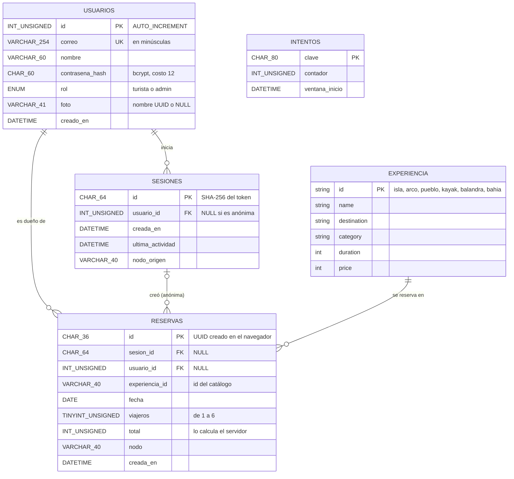

# 1. Modelo de datos

Así está la base de datos de BajaTrip **hoy**, al 25 de noviembre de 2026. El esquema completo está en [`database/schema/bajatrip.sql`](../../database/schema/bajatrip.sql), y el backend lo crea al arrancar (`prepararEsquema()` en `backend/shared/db.js`).

Los datos de BajaTrip viven en tres lugares:

| Dónde | Qué guarda | Quién lo ve |
| --- | --- | --- |
| **MySQL 8.4** (contenedor `db`), compartida por los dos nodos | Cuentas, sesiones, reservas del servidor, límite de intentos | Solo el backend |
| **Navegador** del visitante | Guías locales, reservas de ejemplo, favoritos, búsqueda | Solo ese navegador |
| **Cloudflare** (Durable Object) | Últimos 50 mensajes del chat | Todos los conectados al chat |

El catálogo de experiencias no está en la base: es un arreglo en el código, [`frontend/src/data/experiences.js`](../../frontend/src/data/experiences.js). Lo usan tanto el frontend como el backend, que lo consulta para validar la experiencia y recalcular el precio.

## Diagrama entidad-relación (MySQL)

`EXPERIENCIA` aparece en el diagrama para mostrar de dónde sale `experiencia_id`, pero **no es una tabla**: es el catálogo en código. No hay llave foránea; el backend revisa que el id exista antes de insertar.

## Tablas

### `usuarios`
Una fila por cuenta, creada en `/registro`.

| Columna | Tipo | Llave / restricción | Contenido |
| --- | --- | --- | --- |
| `id` | `INT UNSIGNED` | **PK**, `AUTO_INCREMENT` | Identificador de la cuenta |
| `correo` | `VARCHAR(254)` | **UNIQUE** (`usuarios_correo`), `NOT NULL` | Correo en minúsculas; con él se inicia sesión |
| `nombre` | `VARCHAR(60)` | `NOT NULL` | Letras, espacios, punto, apóstrofo y guion |
| `contrasena_hash` | `CHAR(60)` | `NOT NULL` | Derivación bcrypt (`$2b$12$…`); la contraseña nunca se guarda |
| `rol` | `ENUM('turista','admin')` | `NOT NULL`, por defecto `turista` | Solo se cambia con `backend/scripts/admin.js` |
| `foto` | `VARCHAR(41)` | `NULL` | Nombre UUID del archivo en el volumen `subidas` |
| `creado_en` | `DATETIME` | por defecto `CURRENT_TIMESTAMP` | Alta de la cuenta |

### `sesiones`
Una fila por visitante con cookie `bt_sesion`, con o sin cuenta.

| Columna | Tipo | Llave / restricción | Contenido |
| --- | --- | --- | --- |
| `id` | `CHAR(64)` | **PK** | Huella SHA-256 del token de la cookie (el token no se guarda) |
| `usuario_id` | `INT UNSIGNED` | **FK** → `usuarios.id`, `ON DELETE CASCADE`, `NULL` | Cuenta de la sesión; `NULL` si es anónima |
| `creada_en` | `DATETIME` | por defecto `CURRENT_TIMESTAMP` | |
| `ultima_actividad` | `DATETIME` | por defecto `CURRENT_TIMESTAMP` | Vence a los 30 días sin actividad |
| `nodo_origen` | `VARCHAR(40)` | `NOT NULL` | Nodo que la creó (evidencia de la Práctica 5) |

### `reservas`
Reservas de ejemplo guardadas en el servidor. No se cobra nada y no llegan a ningún prestador.

| Columna | Tipo | Llave / restricción | Contenido |
| --- | --- | --- | --- |
| `id` | `CHAR(36)` | **PK** | UUID creado en el navegador. Si un reintento llega dos veces, la reserva no se duplica |
| `sesion_id` | `CHAR(64)` | **FK** → `sesiones.id`, `ON DELETE SET NULL`, `NULL`, índice | Sesión anónima que la creó |
| `usuario_id` | `INT UNSIGNED` | **FK** → `usuarios.id`, `ON DELETE CASCADE`, `NULL`, índice | Cuenta dueña |
| `experiencia_id` | `VARCHAR(40)` | `NOT NULL` | Id de `experiences.js` |
| `fecha` | `DATE` | `NOT NULL` | Hoy o después (zona horaria de BCS) |
| `viajeros` | `TINYINT UNSIGNED` | `NOT NULL` | De 1 a 6 |
| `total` | `INT UNSIGNED` | `NOT NULL` | `precio × viajeros`, calculado por el servidor |
| `nodo` | `VARCHAR(40)` | `NOT NULL` | Nodo que la guardó |
| `creada_en` | `DATETIME` | por defecto `CURRENT_TIMESTAMP` | |

**Quién es el dueño:** si `usuario_id` tiene valor, la reserva es de esa cuenta. Si es `NULL`, es de la sesión anónima `sesion_id`. Al iniciar sesión, las reservas anónimas de esa sesión pasan a la cuenta. Cada consulta filtra por dueño (`dueno()` en `backend/modules/reservas/reservas.js`). Una cuenta o sesión puede tener hasta 20 reservas.

### `intentos`
Contadores del límite de intentos. Viven en la base y no en la memoria de un nodo, para que los dos nodos compartan la cuenta.

| Columna | Tipo | Llave | Contenido |
| --- | --- | --- | --- |
| `clave` | `CHAR(80)` | **PK** | `entrar:ip:<ip>`, `entrar:correo:<sha256 del correo>` o `registro:ip:<ip>` |
| `contador` | `INT UNSIGNED` | | Intentos en la ventana actual |
| `ventana_inicio` | `DATETIME` | | Inicio de la ventana de 15 minutos |

No tiene relación con las demás tablas a propósito: el correo se guarda como huella, así que la tabla no revela qué cuentas se intentaron.

## Relaciones

| Relación | Cardinalidad | Llave foránea | Al borrar el padre |
| --- | --- | --- | --- |
| usuarios → sesiones | 1 a 0..N | `sesiones.usuario_id` | Se borran sus sesiones (`CASCADE`) |
| usuarios → reservas | 1 a 0..N | `reservas.usuario_id` | Se borran sus reservas (`CASCADE`) |
| sesiones → reservas | 0..1 a 0..N | `reservas.sesion_id` | La reserva se queda; `sesion_id` pasa a `NULL` (`SET NULL`). Por eso cerrar sesión no borra reservas |
| experiencia → reservas | 1 a 0..N | (lógica, sin FK) | El catálogo está en código |

## Datos en el navegador

| Almacén | Nombre | Estructura | Dónde se usa |
| --- | --- | --- | --- |
| IndexedDB | base `bajatrip-guias`, almacén `guias` (versión 2) | `id` autoincremental; `name`, `specialty`, `municipality`, `phone`, `email`, `startDate`, `photo` (Blob), `languages` (lista). Índices `municipality` y `languages` (*multiEntry*) | `/guias` (Práctica 4), [`frontend/src/guides/guidesDb.js`](../../frontend/src/guides/guidesDb.js) |
| IndexedDB | base `bajatrip`, almacén `reservas` (versión 1) | `id` autoincremental; `uuid` (el mismo `id` del servidor), `experienceId`, `name`, `destination`, `date`, `travelers`, `total`, `servidor` (`pendiente`, `guardada` o `rechazada`), `createdAt` | Reservas de ejemplo, [`frontend/src/storage/reservations.js`](../../frontend/src/storage/reservations.js) |
| localStorage | `bajatrip:favoritos` | Lista de ids de experiencias | Favoritos |
| localStorage | `bajatrip-chat-nombre` | Texto | Nombre en el chat |
| sessionStorage | `bajatrip:busqueda` | `{ destino, actividad, viajeros }` | Buscador de Inicio y Catálogo |

Ningún dato de la cuenta (token, correo, rol) se guarda en el navegador: la cookie `bt_sesion` es `HttpOnly` y JavaScript no la puede leer.

## Archivos

Las fotos de perfil no van en la base. Se guardan en el volumen de Docker `subidas` (`/app/subidas` en los dos nodos), con un nombre `<uuid>.jpg|png|webp`, y `usuarios.foto` guarda ese nombre.
