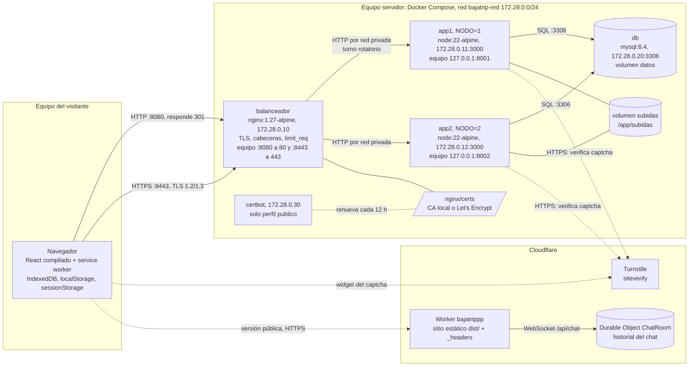

# 2. Diagrama de despliegue

Este es el despliegue que de verdad usamos: el de [`docker-compose.yml`](../../docker-compose.yml), con un balanceador, dos nodos y una base, en un solo equipo. Además está la versión pública en Cloudflare.

## Nodos y artefactos

| Nodo | Imagen / software | IP en `bajatrip-red` | Puertos | Qué ejecuta | Datos |
| --- | --- | --- | --- | --- | --- |
| `balanceador` | `nginx:1.27-alpine` | 172.28.0.10 | `8080→80` (redirige), `8443→443` (HTTPS) | Termina TLS, pone las cinco cabeceras de seguridad, limita `/api/auth/`, reparte con turno rotatorio (`least_conn` opcional) | Configuración: `nginx/templates/default.conf.template`. Certificados: `nginx/certs/` o `nginx/letsencrypt/` |
| `app1` | Imagen del [`Dockerfile`](../../Dockerfile) (`node:22-alpine`) | 172.28.0.11 | `3000`; en el equipo solo `127.0.0.1:8001` | `backend/server.js` con `NODO=1`: API, sesión y `dist/` | Volumen `subidas` |
| `app2` | La misma imagen | 172.28.0.12 | `3000`; en el equipo solo `127.0.0.1:8002` | Lo mismo con `NODO=2` | Volumen `subidas` (el mismo) |
| `db` | `mysql:8.4` | 172.28.0.20 | `3306` (solo dentro de la red) | Base `bajatrip`, usuario `bajatrip` | Volumen `datos` |
| `certbot` | `certbot/certbot:v3.1.0` | 172.28.0.30 | — | Solo con `--profile publico`: renueva el certificado de Let's Encrypt | `nginx/letsencrypt/`, volumen `certbot-web` |
| Cloudflare Worker | `wrangler deploy` (`wrangler.toml`, nombre `bajatrippp`) | — | 443 | Sirve `dist/` con `_headers` y el chat (`/api/chat`) | Durable Object `ChatRoom` |
| Cloudflare Turnstile | Servicio externo | — | 443 | Captcha del registro | — |

## Comunicaciones

| De → a | Protocolo | Cifrado | Notas |
| --- | --- | --- | --- |
| Navegador → balanceador | HTTP/1.1 y HTTP/2 | TLS 1.2/1.3 en 443; el 80 solo responde 301 | HSTS en las respuestas |
| Balanceador → nodos | HTTP/1.1 | No: red privada de Docker | El nodo solo cree `X-Real-IP` y `X-Forwarded-Proto` si vienen de 172.28.0.10 (`PROXIES_CONFIABLES`) |
| Nodos → MySQL | Protocolo MySQL | No: red privada | Pool de 10 conexiones por nodo; `/salud` responde 503 si la base no contesta |
| Nodos → Turnstile | HTTPS | Sí | Si no responde, el registro se rechaza (falla cerrado) |
| Navegador → Worker | HTTPS / WSS | Sí | Solo la versión pública; ahí no hay cuentas |

## Por qué está así

- **Un balanceador y dos nodos iguales** (misma imagen, solo cambia `NODO`). Así se configuró y midió en la Práctica 5 ([informe](../practica-5/Practica5-Balanceo-BajaTrip.pdf)).
- **El certificado solo está en el balanceador** y el tramo interno va por una red privada. La justificación está en la [Tarea 4](../tarea-4/tarea-4-firma-certificados-https.pdf), sección 8.
- **El estado compartido vive en la base o en un volumen compartido**, nunca en un nodo: sesiones, reservas y contadores de intentos en MySQL, y fotos en el volumen `subidas`. Por eso cualquier nodo puede atender cualquier petición.
- **Los nodos no se exponen a la red:** sus puertos solo escuchan en `127.0.0.1` del equipo. Desde otra computadora solo se llega por el balanceador.

## Variante en tres computadoras

Para la variante de la Práctica 5 con tres equipos, cada nodo ejecuta `node backend/server.js` con `NODO`, `DB_HOST`, `DB_PASSWORD` y `PROXIES_CONFIABLES`. En la plantilla de Nginx se cambian las IP del `upstream` por las de los equipos. En ese caso el volumen `subidas` tendría que ser una carpeta compartida (por ejemplo NFS) o un almacenamiento como R2. También convendría cifrar el tramo balanceador–nodos, porque ya no sería una red privada de un solo equipo.
