# 4. Manual de usuario

BajaTrip es un sitio para descubrir experiencias turísticas en Baja California Sur: tours en lancha, kayak, pueblos y playas. Este manual explica las tareas principales. Las capturas son del sistema funcionando en `https://localhost:8443` (manual de instalación, sección 7).

> **Importante:** BajaTrip es una demostración. Las fotografías, servicios y precios son ilustrativos; las reservas no se cobran y no se envían a ningún prestador.

## Contenido
1. [Explorar y buscar experiencias](#1-explorar-y-buscar-experiencias)
2. [Ver el detalle y probar una reserva](#2-ver-el-detalle-y-probar-una-reserva)
3. [Catálogo y galería](#3-catálogo-y-galería)
4. [Favoritos y Mis viajes](#4-favoritos-y-mis-viajes)
5. [Catálogo de guías locales](#5-catálogo-de-guías-locales)
6. [Crear una cuenta](#6-crear-una-cuenta)
7. [Iniciar sesión, foto de perfil y cerrar sesión](#7-iniciar-sesión-foto-de-perfil-y-cerrar-sesión)
8. [Reservas en tu cuenta](#8-reservas-en-tu-cuenta)
9. [Panel de administración](#9-panel-de-administración)
10. [Chat en vivo](#10-chat-en-vivo)
11. [Uso en el celular y sin conexión](#11-uso-en-el-celular-y-sin-conexión)
12. [Mensajes que puedes ver](#12-mensajes-que-puedes-ver)

---

## 1. Explorar y buscar experiencias

La página de **Inicio** muestra el buscador, los destinos y las experiencias.

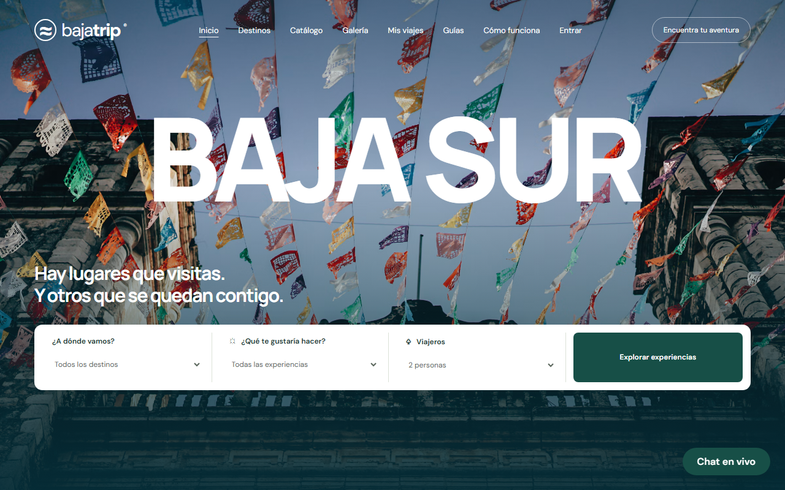

1. En **¿A dónde vamos?** elige un destino (La Paz, Los Cabos, Loreto…).
2. En **¿Qué te gustaría hacer?** elige una actividad (Mar y playa, Aventura, Cultura y sabores). Es opcional.
3. En **Viajeros** indica cuántas personas van (de 1 a 6). El precio se calcula con este número.
4. Pulsa **Explorar experiencias**.

Arriba de los resultados se indica cuántas experiencias hay. Los botones de categoría (Todas, Mar y playa…) y los destinos (Los Cabos, La Paz…) filtran sin volver a buscar. La búsqueda se conserva si recargas la página o pasas al Catálogo.

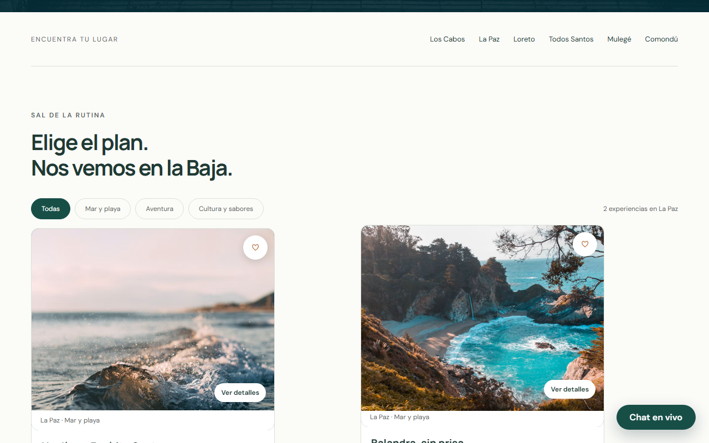

Si no hay resultados, aparece «Tu próxima aventura está por llegar» con el botón **Ver todas las experiencias**.

## 2. Ver el detalle y probar una reserva

1. En una tarjeta, pulsa **Ver detalles**. Se abre una ventana con la descripción, lo que incluye y el precio total para los viajeros elegidos.
2. Elige la **Fecha de tu aventura**. Debe ser hoy o después.
3. Pulsa **Probar reserva de ejemplo**. Abajo aparece el resumen y dónde se guardó: en este navegador y, si el servidor está disponible, también en el servidor.
4. Cierra con **✕** o con la tecla **Esc**.

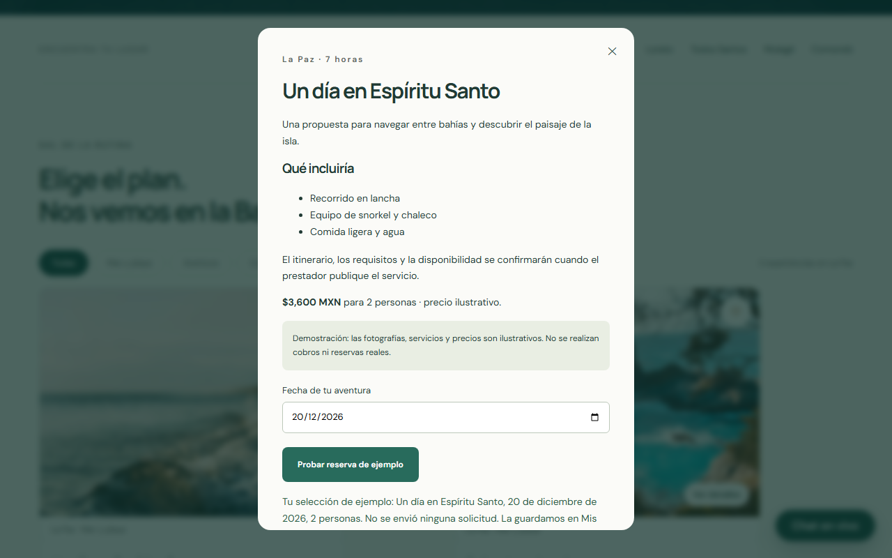

## 3. Catálogo y galería

- **Catálogo** (menú › Catálogo): todas las experiencias con el mismo buscador.

  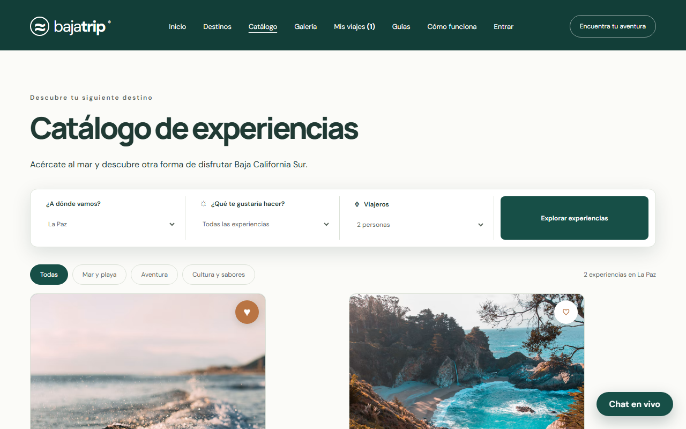

- **Galería** (menú › Galería): fotografías de los destinos. Pulsa una para verla en grande. Si tu sistema tiene activado «reducir movimiento», las animaciones se apagan.

  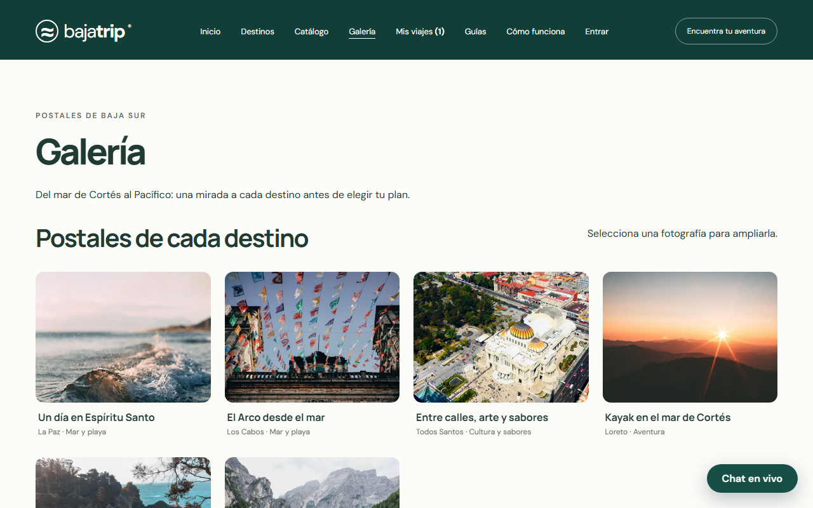

## 4. Favoritos y Mis viajes

- Para guardar una experiencia, pulsa el **corazón** (♡) de su tarjeta; se rellena (♥). En el menú, **Mis viajes** muestra cuántos favoritos tienes. Vuelve a pulsarlo para quitarla.
- **Mis viajes** reúne:
  - **Favoritos**: se quedan en este navegador aunque lo cierres.
  - **Reservas de ejemplo**: las que probaste en este dispositivo, con fecha, destino, viajeros y total. **Eliminar** la borra aquí y en el servidor.
  - Cuando el sitio corre con el servidor, un aviso indica qué nodo te atendió. **Consultar otra vez** lo vuelve a preguntar (sirve para ver el balanceo).

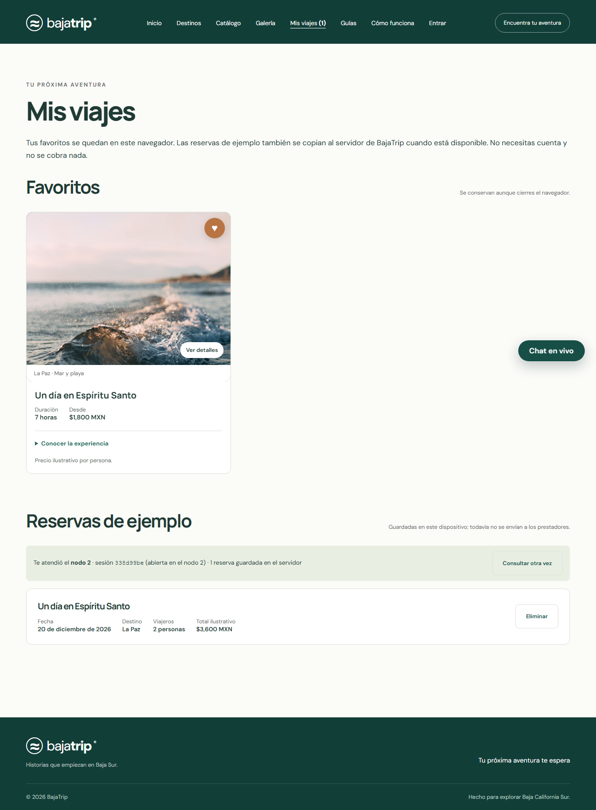

## 5. Catálogo de guías locales

En **Guías** se registran las personas guías. Se guardan en este navegador y funcionan sin conexión.

**Registrar un guía:**
1. Llena **Nombre completo**, **Especialidad**, **Municipio**, **Teléfono**, **Correo electrónico** y **Fecha de ingreso**.
2. Marca los **idiomas** que habla (al menos uno).
3. Opcional: elige una **Fotografía**. Se reduce a 480 px.
4. Pulsa **Registrar guía**.

**Buscar:** en *Catálogo de guías*, elige **Municipio** o **Idioma** y pulsa **Buscar guías**. **Mostrar todos** quita el filtro. La gráfica *Distribución* cuenta cuántos guías hay en cada municipio; **Ver los datos en una tabla** muestra los mismos números como tabla.

**Modificar o dar de baja:** en la tarjeta del guía, **Modificar** carga sus datos en el formulario; **Dar de baja** pide confirmación antes de borrarlo.

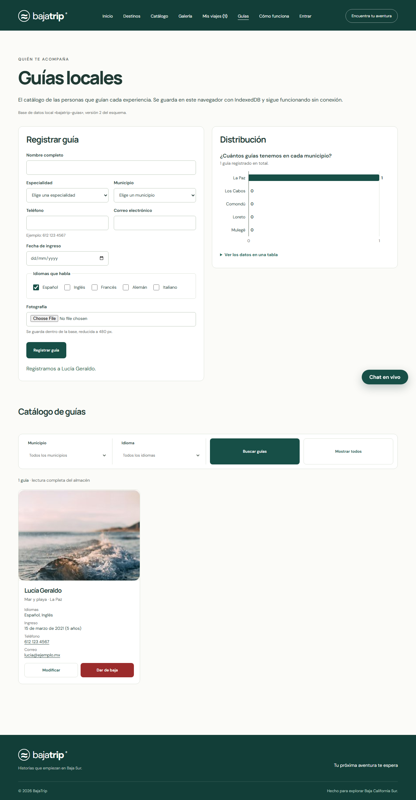

## 6. Crear una cuenta

Una cuenta guarda tus reservas en el servidor para verlas desde cualquier dispositivo.

1. Menú › **Entrar** › **Crea una** (o directamente `/registro`).
2. Escribe tu **Nombre**, **Correo electrónico** y una **Contraseña** de 8 a 72 caracteres. Una frase de varias palabras es fácil de recordar y difícil de adivinar. Repítela en **Confirma la contraseña**.
3. Espera a que la verificación de Cloudflare muestre la palomita (casi siempre se resuelve sola).
4. Pulsa **Crear cuenta**.

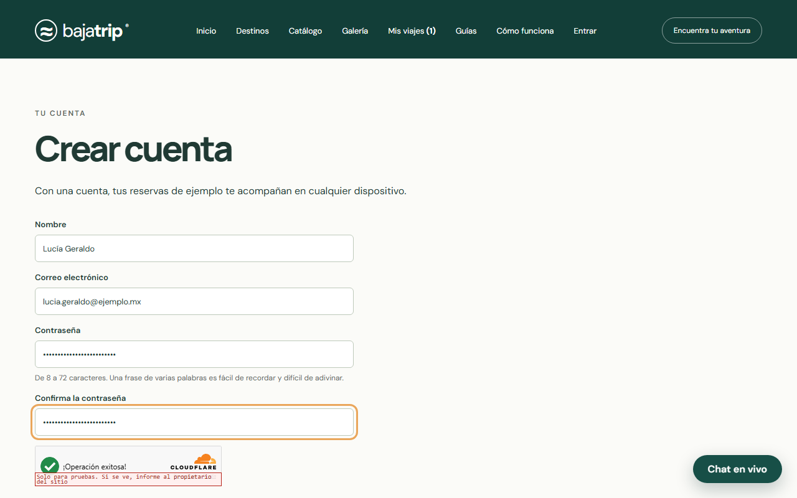

Al terminar aparece: «Si el correo no tenía cuenta, ya quedó lista. Inicia sesión para continuar.». El mensaje es igual aunque el correo ya estuviera registrado, para no revelar qué correos tienen cuenta. Si ya tenías cuenta, usa tu contraseña de siempre.

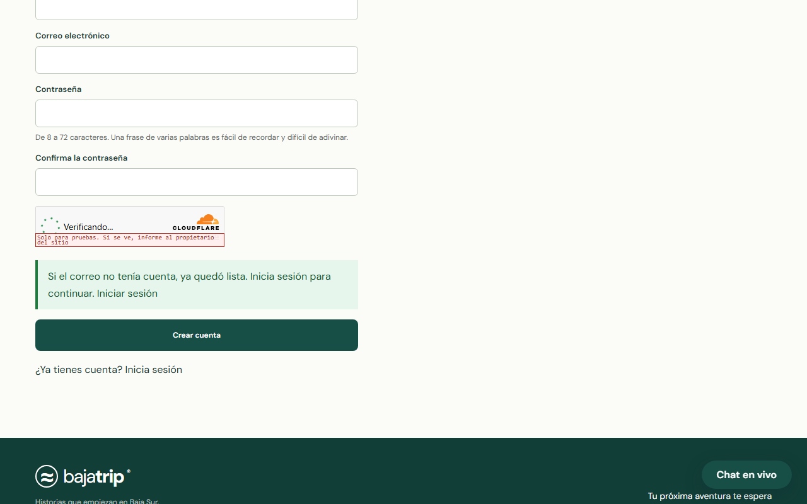

## 7. Iniciar sesión, foto de perfil y cerrar sesión

**Iniciar sesión:** menú › **Entrar**, escribe tu correo y contraseña y pulsa **Entrar**. Si algún dato está mal verás «Correo o contraseña incorrectos.». Después de 5 intentos fallidos la cuenta se bloquea 15 minutos.

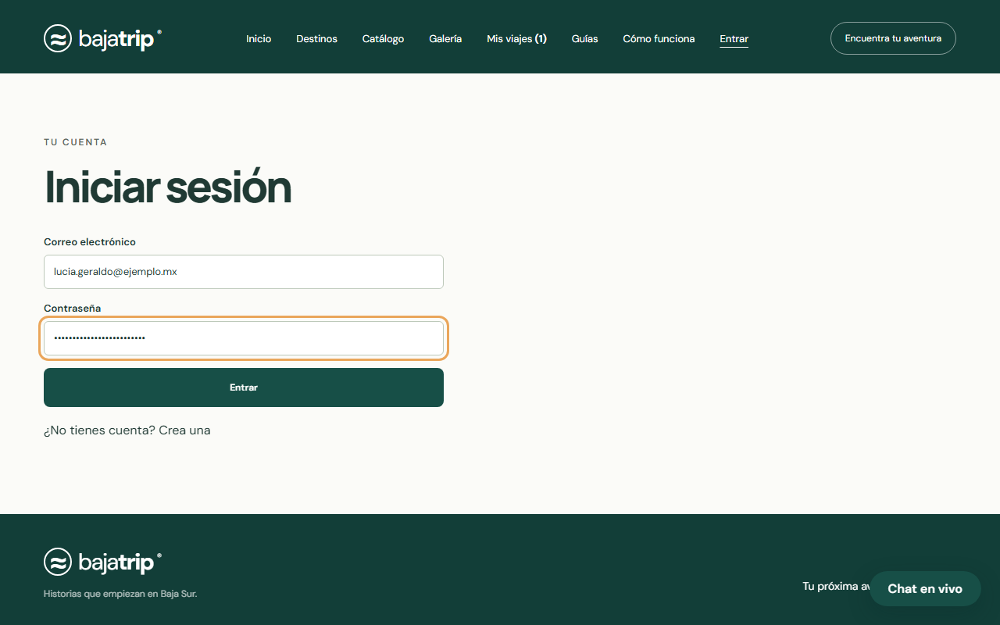

**Mi cuenta:** después de entrar, el menú muestra **Mi cuenta**. Ahí ves tu nombre y correo y puedes:
- **Subir una foto de perfil:** elige un archivo JPG, PNG o WebP de hasta 2 MB y pulsa **Subir foto**. Solo tú la ves.
- Ir a **Mis viajes**.
- **Cerrar sesión**. La sesión se cierra también en el servidor; si usas una computadora compartida, ciérrala siempre.

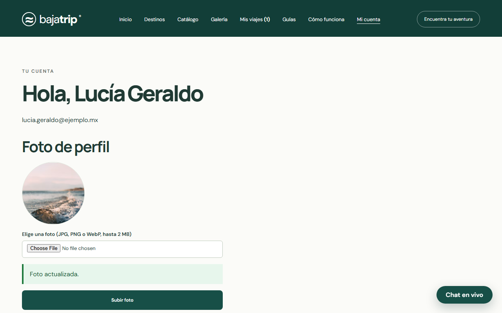

## 8. Reservas en tu cuenta

Con la sesión iniciada, las reservas de ejemplo que hagas (sección 2) se guardan a tu nombre. Las que hiciste antes de entrar en ese navegador también pasan a tu cuenta. En **Mis viajes**, la sección **En tu cuenta** las lista; pulsa una para ver su detalle.

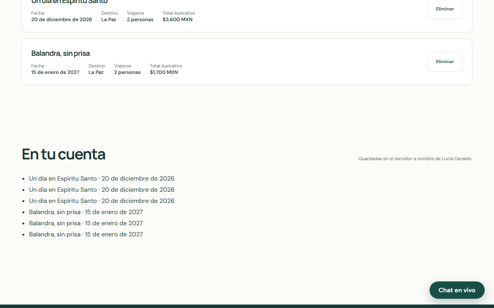

El detalle muestra la fecha, el destino, los viajeros, el total calculado por el servidor y el nodo que la guardó. Su dirección (`/mis-viajes/reserva/…`) solo funciona para ti: si otra persona la abre, verá «No encontramos esa reserva.».

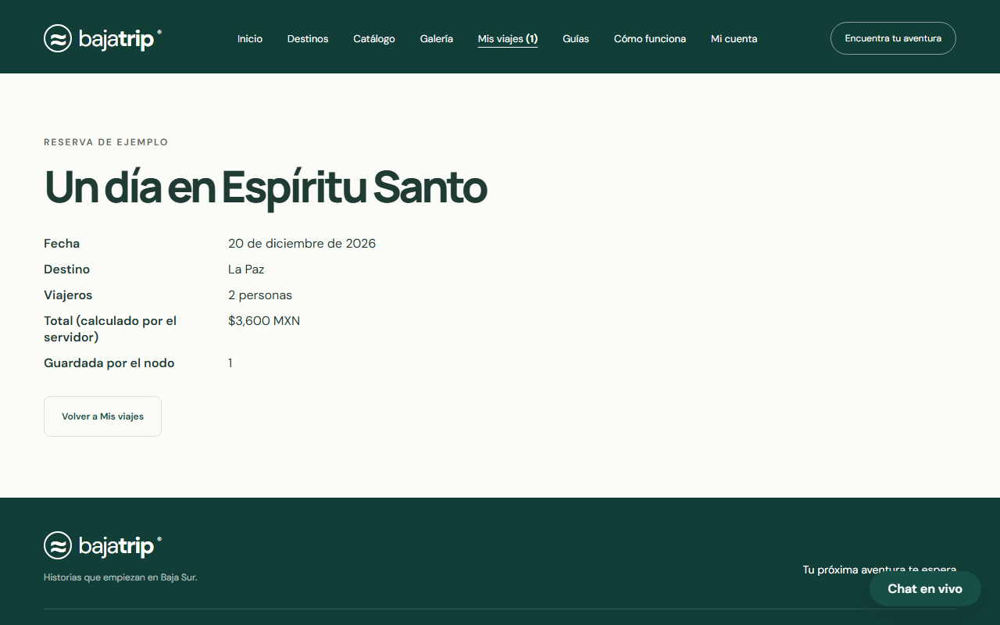

## 9. Panel de administración

Solo para cuentas con rol de administrador. El rol se asigna desde el servidor, nunca desde la página (manual de instalación, sección 9). Con una cuenta administradora, **Mi cuenta** muestra **Panel de administración**, que lista las cuentas registradas con los correos enmascarados. Si una cuenta normal entra a `/admin`, ve «No tienes permiso para ver esto.».

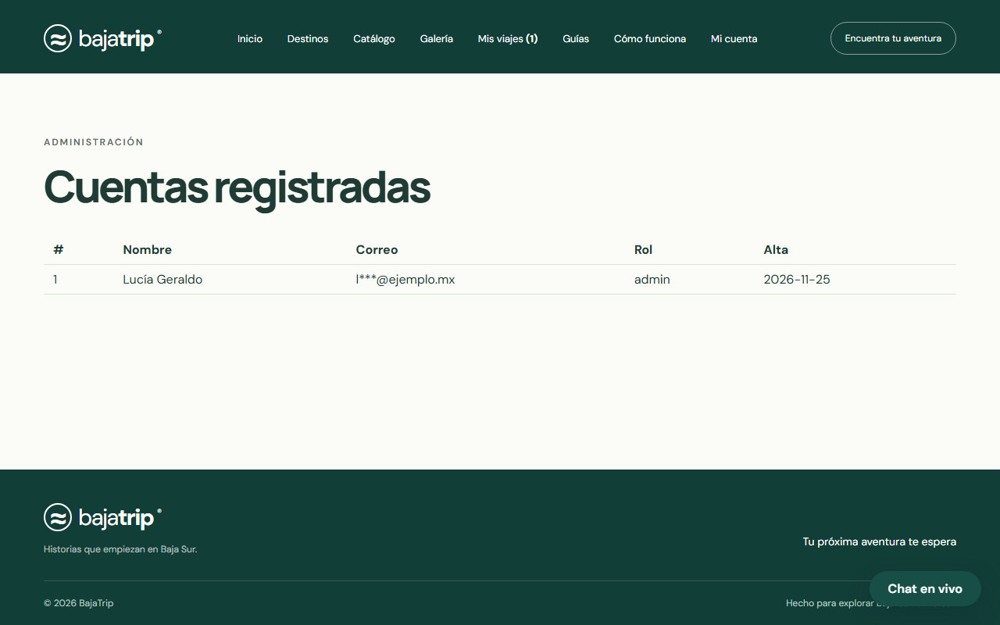

## 10. Chat en vivo

El botón **Chat en vivo** (abajo a la derecha) abre una sala para hablar con otros visitantes. Escribe tu nombre y tu mensaje y pulsa **Enviar**. El chat funciona en la versión publicada en Cloudflare. En la instalación con Docker el botón aparece, pero la sala no se conecta, porque el chat vive en Cloudflare.

## 11. Uso en el celular y sin conexión

El sitio se adapta a pantallas desde 320 px: el menú se acomoda en varias líneas y las tarjetas en una columna.

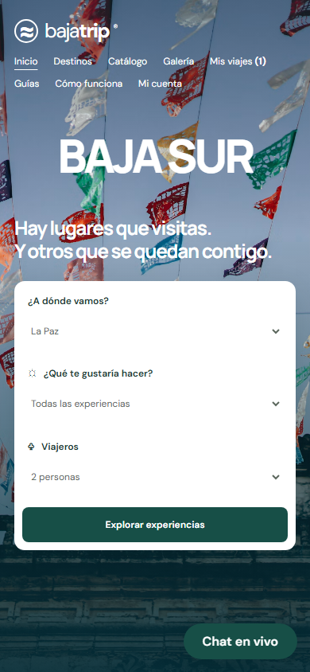

Después de la primera visita, el sitio compilado funciona **sin conexión**: el catálogo, los favoritos, las reservas guardadas en el dispositivo y los guías siguen disponibles. Un aviso abajo indica «Sin conexión». Lo que necesita al servidor (cuentas, reservas en el servidor) y las fotografías de Unsplash vuelven al recuperar la señal; las reservas pendientes se envían solas la próxima vez que abras Mis viajes.

## 12. Mensajes que puedes ver

| Mensaje | Qué significa | Qué hacer |
| --- | --- | --- |
| «Correo o contraseña incorrectos.» | Algún dato no coincide | Revisa el correo y la contraseña |
| «Demasiados intentos. Espera N minutos…» | Se bloqueó temporalmente por intentos fallidos | Espera el tiempo indicado |
| «No pudimos comprobar que eres una persona…» | La verificación del registro falló o caducó | Vuelve a resolverla y envía otra vez |
| «Solo se aceptan fotos JPG, PNG o WebP.» | El archivo no es una imagen válida | Elige otra foto |
| «La solicitud es demasiado grande.» | La foto pesa más de 2 MB | Usa una foto más ligera |
| «No encontramos esa reserva.» | La reserva no existe o no es tuya | Ábrela desde tu propia cuenta |
| «No tienes permiso para ver esto.» | La página es solo para administradores | — |
| «Las cuentas solo funcionan en el servidor de BajaTrip…» | Estás en la versión de demostración sin servidor | Usa la instalación completa |
| «Sin conexión: algunas fotografías no cargarán…» | El dispositivo no tiene internet | Sigue usando lo guardado; se actualiza al volver la señal |
